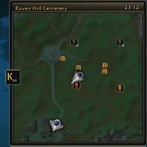

# KeijinUI

Many thanks to [SurvivorsDragonUi](https://github.com/migwynkriid13/SurvivorsDragonUi) and [Survivor UI](https://github.com/morderous/survivor-ui), the two projects that inspired this interface.

A complete, consistent interface for **Azeroth Survivors** (WoW 1.12 client, Interface 11200).
English first, [Deutsch below](#deutsch).

## English

### What it is

KeijinUI replaces the stock Azeroth Survivors HUD with one interface in a single visual style:

* **Run overview**: zone, run clock, boss schedule with boss time and run time, pace against your best matching runs, guardian lairs with status and small direction arrows
* **Minimap** (game 0.102 or newer): a skull for every guardian lair, gold while a guardian holds it, orange with ! in combat, grey with x when empty; the game's red flag is hidden while the skulls are on. Caches with edge arrows, clock with time zone
* **Run statistics** and a **meter** with Run, Boss and Healing tabs: totals and DPS/HPS per source, biggest critical hits, damage taken by source
* **Character values**: up to 29 stats, your choice and order
* **Player and target frames** with round portrait, debuffs, absorb shield, raid markers and an optional 30 percent marker, action bar with ranks and cooldowns, build overview with spells, cooldown tabs on the icons, jewelry cooldowns and a build tip
* **Effects bar** for talent and item timers, **summons bar** for demons, beasts, treants, spirit wolves and water elementals
* **Co-op**: party window with health, revive progress and a Party tab in the meter with damage and DPS of every hero
* **Raid markers**: right click the target frame, your own frame or a party row, or use `/kui mark 1-8` and key bindings
* **Kills, gold and caches** with lives and rerolls, XP bar with XP per minute and time to the next level, stored level ups button
* Encounter bars with boss and guardian debuffs, modern nameplates, calmer floating damage numbers with a size slider, optional healing and incoming damage text, spell, item and talent icons in the meter
* Loot list in four modes with new and collected marks, achievement popup, one chat window with a copy button
* **Settings** in four categories with a live search in English and German, whatever your UI language
* **Layout mode**: hold Alt, drag and resize with the mouse wheel; windows snap to the grid, to each other and to the screen edges, and windows docked above the chat grow upward
* Run history per zone, class and race (`/kui runs`), class and account pace, searchable jewelry diary, optional modules you can switch off completely
* **All 14 game languages** (English and German checked by hand, the others machine translated) and **seven interface fonts** with preview

### Installation

1. Download `KeijinUI-x.y.z.zip` from the latest [release](https://github.com/KeijinDE/KeijinUI_modern-as-ui/releases/latest) (not "Source code").
2. Unpack it into the AddOns folder of the game, so that `AddOns/KeijinUI/KeijinUI.toc` exists.
3. Disable SurvivorsDragonUi, SurvivorUI, KeijinBuildBar, KeijinRunCounters and KeijinAchievements, because KeijinUI contains their functions.
4. Restart the game completely.

### First steps

* `/kui` or a left click on the **Kui** minimap button opens the settings; type into the search field to find any option.
* Hold **Alt** to see all frames, drag them with the left mouse button, Alt and mouse wheel changes the size. Shift while releasing places a frame without snapping.
* `/kui lang <code>` switches the language (de, en, fr, es, pt, pl, cs, ro, tr, ru, uk, zh, ja, ko), English is the default. The font is under General, Font.
* `/kui reset` restores the default layout.
* Right click on the **Kui** button opens the run history. Its position can be chosen under Layout & Display, Minimap.

All commands and details are in [KeijinUI/README.md](KeijinUI/README.md). The full version history is in [CHANGELOG.md](KeijinUI/CHANGELOG.md).

### Credits

* KeijinUI is my own work: code and bundled graphics were written or generated for this project. No code or textures of other addons are included.
* SurvivorsDragonUi and Survivor UI served as inspiration and functional models for what an Azeroth Survivors interface can show.
* Icons, portraits and some status bars are referenced from the game client by path and are not shipped. They belong to Blizzard Entertainment.

## Deutsch

Vielen Dank an [SurvivorsDragonUi](https://github.com/migwynkriid13/SurvivorsDragonUi) und [Survivor UI](https://github.com/morderous/survivor-ui), die beiden Projekte, die als Inspiration für diese Oberfläche dienten.

Eine vollständige, einheitliche Oberfläche für **Azeroth Survivors** (WoW 1.12 Client, Interface 11200).

### Was es ist

KeijinUI ersetzt die Standardanzeigen von Azeroth Survivors durch eine Oberfläche in einem Stil:

* **Runübersicht**: Zone, Runuhr, Bossplan mit Bosszeit und Runzeit, Pace im Vergleich mit deinen besten passenden Runs, Wächterhorte mit Status und kleinen Richtungspfeilen
* **Minimap** (ab Spiel 0.102): ein Totenkopf für jeden Wächterhort, gold bei besetztem Hort, orange mit ! im Kampf, grau mit x bei leerem Hort; die rote Flagge des Spiels ist ausgeblendet, solange die Totenköpfe an sind. Caches mit Randpfeilen, Uhr mit Zeitzone
* **Runstatistik** und **Meter** mit den Reitern Run, Boss und Heilung: Summen und DPS/HPS je Quelle, größte kritische Treffer, erlittener Schaden nach Quelle
* **Charakterwerte**: bis zu 29 Werte, Auswahl und Reihenfolge frei
* **Spieler und Zielframe** mit rundem Porträt, Debuffs, Absorbschild, Schlachtzugsmarkern und optionaler 30 Prozent Markierung, Aktionsleiste mit Rängen und Abklingzeiten, Buildübersicht mit Zaubern, Abklingzeit am Symbol, Schmuckcooldowns und Buildtipp
* **Effektleiste** für Talent und Itemtimer, **Beschwörungsleiste** für Dämonen, Wildtiere, Treants, Geisterwölfe und Wasserelementare
* **Koop**: Gruppenfenster mit Gesundheit, Wiederbelebungsfortschritt und Reiter Party im Meter mit Schaden und DPS jedes Helden
* **Schlachtzugsmarker**: Rechtsklick auf Zielframe, eigenen Frame oder eine Gruppenzeile, alternativ `/kui mark 1-8` und Tastenbelegungen
* **Kills, Gold und Caches** mit Leben und Rerolls, EP Leiste mit EP pro Minute und Zeit bis zum nächsten Level, Knopf für gespeicherte Levelaufstiege
* Begegnungsbalken mit Debuffs von Bossen und Wächtern, moderne Namensplaketten, ruhigere Schadenszahlen mit Größenregler, optionaler Heil und Schadenstext am Spieler, Zauber, Item und Talentsymbole im Meter
* Beuteliste in vier Modi mit Markierung neu und gesammelt, Erfolgsmeldung, ein Chatfenster mit Kopierknopf
* **Einstellungen** in vier Kategorien mit Livesuche auf Deutsch und Englisch, unabhängig von der UI Sprache
* **Layoutmodus**: Alt halten, ziehen und mit dem Mausrad skalieren; Fenster rasten am Raster, aneinander und am Bildschirmrand ein, über dem Chat angedockte Fenster wachsen nach oben
* Rundenübersicht je Zone, Klasse und Volk (`/kui runs`), Klassen und Accountpace, durchsuchbares Schmucktagebuch, optionale Module, die sich ganz abschalten lassen
* **Alle 14 Spielsprachen** (Englisch und Deutsch von Hand geprüft, die übrigen maschinell übersetzt) und **sieben Oberflächenschriften** mit Vorschau

### Installation

1. `KeijinUI-x.y.z.zip` aus dem neuesten [Release](https://github.com/KeijinDE/KeijinUI_modern-as-ui/releases/latest) herunterladen (nicht „Source code“).
2. In den AddOns Ordner des Spiels entpacken, sodass `AddOns/KeijinUI/KeijinUI.toc` existiert.
3. SurvivorsDragonUi, SurvivorUI, KeijinBuildBar, KeijinRunCounters und KeijinAchievements deaktivieren, weil KeijinUI deren Funktionen enthält.
4. Das Spiel vollständig neu starten.

### Erste Schritte

* `/kui` oder ein Linksklick auf den Minimapknopf **Kui** öffnet die Einstellungen; im Suchfeld findest du jede Option.
* **Alt** halten zeigt alle Rahmen, mit der linken Maustaste verschieben, Alt und Mausrad ändern die Größe. Shift beim Loslassen platziert ohne Einrasten.
* `/kui lang <Code>` wechselt die Sprache (de, en, fr, es, pt, pl, cs, ro, tr, ru, uk, zh, ja, ko), Standard ist Englisch. Die Schrift steht unter Allgemein, Schrift.
* `/kui reset` stellt das Standardlayout wieder her.
* Rechtsklick auf **Kui** öffnet die Rundenübersicht. Die Position des Knopfs lässt sich unter Layout & Anzeige, Minimap wählen.

Alle Befehle und Details stehen in [KeijinUI/README.md](KeijinUI/README.md). Der vollständige Versionsverlauf steht in [CHANGELOG.md](KeijinUI/CHANGELOG.md).

### Danksagung

* KeijinUI ist eigene Arbeit: Code und mitgelieferte Grafiken wurden für dieses Projekt geschrieben oder erzeugt. Code oder Texturen anderer Addons sind nicht enthalten.
* SurvivorsDragonUi und Survivor UI dienten als Inspiration und funktionale Vorbilder dafür, was eine Oberfläche für Azeroth Survivors anzeigen kann.
* Symbole, Porträts und einige Statusleisten werden aus dem Spielclient über ihren Pfad referenziert und nicht mitgeliefert. Sie gehören Blizzard Entertainment.
