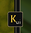

# KeijinUI

Many thanks to [SurvivorsDragonUi](https://github.com/migwynkriid13/SurvivorsDragonUi) and [Survivor UI](https://github.com/morderous/survivor-ui), the two projects that inspired this interface.

A complete, consistent interface for **Azeroth Survivors** (WoW 1.12 client, Interface 11200).
English first, [Deutsch below](#deutsch).

## English

### What it is

KeijinUI replaces the stock Azeroth Survivors HUD with one interface in a single visual style:

* Run overview with zone, run clock, progress and boss schedule (boss time and run time), below it the guardian lairs of the map (asleep, fighting, back in, due)
* Run statistics: elites, guardians and bosses defeated, damage taken, effective healing, gold earned; a counter row with the gold still missing for the next cache (green, yellow, red)
* Pace: kill progress and recent DPS compared with your earlier matching runs at the same run time (green, yellow, red; on by default, switchable)
* Damage meter with total and DPS per ability, list of the biggest critical hits
* Player and target frames with round portrait and joined health bar, square minimap, action bar with ranks and cooldowns
* Build overview with spells, jewelry and a build tip
* Encounter bars for bosses, elites and rares, modern nameplates, scrolling combat text with spell icons
* Loot notice, achievement popup and one chat window in the same frame style
* Settings window with a side navigation (Display, Combat, Units, Controls, Layout, General), checkboxes, a live combat text preview, layout mode with grid and snapping, a ready made default layout
* Optional cursor ring and optional character attributes (both off by default)
* Class resources: rogue combo points, warlock soul shards and warrior rage; attached to the player or movable with Alt
* Caches on the minimap with a pointer to the nearest one, optional screen arrow
* Run history per zone, class and race (`/kui runs`): runs, wins, last time, fastest win and longest survival, plus a start message in chat for every run; a win is saved as a fixed snapshot the moment it happens, also when you leave straight to the menu
* Minimap button **Kui**: left click opens the settings, right click the run history, drag it along the minimap edge
* Original chamfered frames with warm bronze unit borders
* English and German interface

### Installation

1. Download `KeijinUI-x.y.z.zip` from the latest [release](https://github.com/KeijinDE/KeijinUI_modern-as-ui/releases/latest) (not "Source code").
2. Unpack it into the AddOns folder of the game, so that `AddOns/KeijinUI/KeijinUI.toc` exists.
3. Disable SurvivorsDragonUi, SurvivorUI, KeijinBuildBar, KeijinRunCounters and KeijinAchievements, because KeijinUI contains their functions.
4. Restart the game completely.

### First steps

* `/kui` opens the settings window.
* Hold **Alt** to see all frames, drag them with the left mouse button, Alt and mouse wheel changes the size.
* `/kui lang de` switches to German, `/kui lang en` back to English (default).
* `/kui reset` restores the default layout.
* The **Kui** button on the minimap opens the settings (left click) and the run history (right click).

All commands and details are in [KeijinUI/README.md](KeijinUI/README.md). The full version history is in [CHANGELOG.md](KeijinUI/CHANGELOG.md).

### Credits

* KeijinUI is my own work: code and bundled graphics were written or generated for this project. No code or textures of other addons are included.
* SurvivorsDragonUi and Survivor UI served as inspiration and functional models for what an Azeroth Survivors interface can show.
* Icons, portraits and some status bars are referenced from the game client by path and are not shipped. They belong to Blizzard Entertainment.

## Deutsch

Vielen Dank an [SurvivorsDragonUi](https://github.com/migwynkriid13/SurvivorsDragonUi) und [Survivor UI](https://github.com/morderous/survivor-ui), die beiden Projekte, die als Inspiration für diese Oberfläche dienten.

Eine vollständige, einheitliche Oberfläche für **Azeroth Survivors** (WoW 1.12 Client, Interface 11200).

### Was es ist

KeijinUI ersetzt die Standardanzeigen von Azeroth Survivors durch eine Oberfläche in einem Stil:

* Runübersicht mit Zone, Runuhr, Fortschritt und Bossplan (Bosszeit und Runzeit), darunter die Wächterhorte der Karte (schläft, im Kampf, zurück in, fällig)
* Runstatistiken: Eliten, Wächter und Bosse besiegt, Schaden erlitten, effektive Heilung, Gold verdient; eine Zählerzeile mit dem noch fehlenden Gold für den nächsten Cache (grün, gelb, rot)
* Pace: Killfortschritt und aktuelle DPS im Vergleich mit deinen früheren passenden Runs zur selben Runzeit (grün, gelb, rot; standardmäßig an, abschaltbar)
* Schadensanzeige mit Gesamtschaden und DPS je Fähigkeit, Liste der größten kritischen Treffer
* Spieler und Zielframe mit rundem Porträt und angeschlossenem Lebensbalken, eckige Minimap, Aktionsleiste mit Rängen und Abklingzeiten
* Buildübersicht mit Zaubern, Schmuck und Buildtipp
* Begegnungsbalken für Bosse, Eliten und Rares, moderne Namensplaketten, scrollender Kampftext mit Zaubersymbolen
* Beutemeldung, Erfolgsmeldung und ein Chatfenster im gleichen Rahmenstil
* Optionsfenster mit Seitennavigation (Anzeige, Kampf, Einheiten, Bedienung, Layout, Allgemein), Checkboxen, Livevorschau des Kampftexts, Layoutmodus mit Raster und Einrasten, fertiges Standardlayout
* Optionaler Cursorring und optionale Charakterwerte (beide standardmäßig aus)
* Klassenressourcen: Combopunkte, Seelensplitter und Wut; am Spieler befestigt oder mit Alt frei beweglich
* Caches auf der Minimap mit Hinweis auf die nächste, optionaler Bildschirmpfeil
* Rundenübersicht je Zone, Klasse und Volk (`/kui runs`): Runs, Siege, letzte Zeit, schnellster Sieg und längstes Überleben, dazu eine Startmeldung im Chat zu jedem Run; ein Sieg wird sofort als fester Snapshot gesichert, auch wenn du direkt ins Menü gehst
* Minimapknopf **Kui**: Linksklick öffnet die Optionen, Rechtsklick die Rundenübersicht, am Minimaprand verschiebbar
* Eigene abgeschrägte Rahmen mit warmen bronzefarbenen Unitkanten
* Oberfläche auf Englisch und Deutsch

### Installation

1. `KeijinUI-x.y.z.zip` aus dem neuesten [Release](https://github.com/KeijinDE/KeijinUI_modern-as-ui/releases/latest) herunterladen (nicht „Source code“).
2. In den AddOns Ordner des Spiels entpacken, sodass `AddOns/KeijinUI/KeijinUI.toc` existiert.
3. SurvivorsDragonUi, SurvivorUI, KeijinBuildBar, KeijinRunCounters und KeijinAchievements deaktivieren, weil KeijinUI deren Funktionen enthält.
4. Das Spiel vollständig neu starten.

### Erste Schritte

* `/kui` öffnet das Optionsfenster.
* **Alt** halten zeigt alle Rahmen, mit der linken Maustaste verschieben, Alt und Mausrad ändern die Größe.
* `/kui lang de` stellt auf Deutsch um, `/kui lang en` zurück auf Englisch (Standard).
* `/kui reset` stellt das Standardlayout wieder her.
* Der Knopf **Kui** an der Minimap öffnet die Optionen (Linksklick) und die Rundenübersicht (Rechtsklick).

Alle Befehle und Details stehen in [KeijinUI/README.md](KeijinUI/README.md). Der vollständige Versionsverlauf steht in [CHANGELOG.md](KeijinUI/CHANGELOG.md).

### Danksagung

* KeijinUI ist eigene Arbeit: Code und mitgelieferte Grafiken wurden für dieses Projekt geschrieben oder erzeugt. Code oder Texturen anderer Addons sind nicht enthalten.
* SurvivorsDragonUi und Survivor UI dienten als Inspiration und funktionale Vorbilder dafür, was eine Oberfläche für Azeroth Survivors anzeigen kann.
* Symbole, Porträts und einige Statusleisten werden aus dem Spielclient über ihren Pfad referenziert und nicht mitgeliefert. Sie gehören Blizzard Entertainment.
